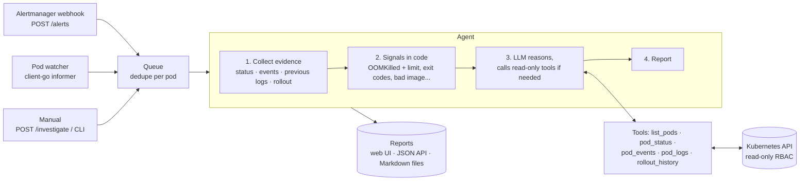

# podmortem

[](https://github.com/Venky-collab/podmortem/actions/workflows/ci.yml)
[](LICENSE)

**An AI agent that writes the post-mortem for your failing Kubernetes pods.**

When a pod starts crash-looping, gets OOMKilled, or can't pull its image, podmortem
collects the evidence an on-call engineer would look at (status, events, logs from
the crashed run, the rollout that preceded it), lets an LLM dig further with
read-only tools, and writes a short root-cause report with a suggested fix.

It runs **fully locally and free** with a small open model through [Ollama](https://ollama.com).
No API keys, no data leaves your machine.

```
## Summary
## Root cause
## Evidence
## Suggested fix
```

## How it works



1. **Triggers.** A Prometheus Alertmanager webhook, a built-in pod watcher that fires
   when a pod *transitions* into a failure state, or a manual request. Repeat triggers
   for the same pod are deduplicated.
2. **Evidence first, model second.** Before the model sees anything, podmortem gathers
   the standard first-look evidence and computes **signals** in plain code: "OOMKilled,
   memory limit is 32Mi", "exit code 137: killed by SIGKILL", "cannot pull image
   busybox:1.36-typo". Deterministic facts make even a 1.5B-parameter local model
   produce grounded answers.
3. **Agent loop.** The model can call read-only tools for more detail, for a bounded
   number of rounds, then must write the report. Tool errors are returned to the model
   as text so it can recover instead of crashing the run.
4. **Reports** are served in a small web UI and JSON API, and optionally written as
   Markdown files.

## Design decisions

- **Read-only by construction.** The tools only call `get`/`list`, and the Helm chart's
  ClusterRole grants only `get/list/watch` on pods, logs, events, deployments and
  replicasets. No access to Secrets.
- **Tools are pinned to the namespace under investigation.** The model can't pass a
  namespace, so a confused or prompt-injected model can't read other teams' workloads
  (there is a test for this).
- **Logs from the previous run.** After a crash, the current container is often empty;
  the error is in `--previous`. podmortem picks this automatically from restart counts.
- **Provider-neutral LLM interface.** The agent depends on a three-method `llm.Client`
  interface. Ollama is the built-in backend; adding a hosted model is one file.
- **Bounded cost and time.** Max tool rounds, per-investigation timeout, output
  truncation (logs keep the *tail*, where crashes are), a bounded queue, and a dedupe
  window so a flapping pod doesn't trigger 100 investigations.
- **Observable.** `/metrics` exposes Prometheus counters for triggers, skips, completed
  and failed investigations, and queue depth; `/healthz` for probes.

## Quick start (local, free)

### Prerequisites

macOS with [Homebrew](https://brew.sh) (Linux works the same with your package manager):

```bash
brew install go ollama colima docker kind kubectl
colima start --memory 3     # free, open-source Docker engine
ollama serve &              # or: brew services start ollama
ollama pull qwen2.5:1.5b    # ~1 GB, one time
```

Any Ollama model with tool calling works; bigger ones (e.g. `qwen2.5:7b`) give
better reports if you have the RAM. Set it with `--model` or `PODMORTEM_MODEL`.

### Run the demo

```bash
make demo
```

This creates a local [kind](https://kind.sigs.k8s.io) cluster, deploys four apps that
are broken in different ways, and starts podmortem watching them:

| App | What's wrong |
|---|---|
| `checkout` | Crash loop: exits because `DATABASE_URL` is not set |
| `cart` | OOMKilled: needs more memory than its 32Mi limit |
| `catalog` | Bad deploy: image tag `busybox:1.36-typo` doesn't exist |
| `payments` | References a ConfigMap that doesn't exist |

Open <http://localhost:8080> to see the reports as they arrive (also saved in `./reports`).
Clean up with `make demo-down`.

### Investigate a single pod

```bash
go build -o bin/podmortem ./cmd/podmortem
bin/podmortem investigate demo-shop/checkout-7c9d8f6b5-x2k4p
```

### Deploy in a cluster

```bash
helm install podmortem deploy/helm/podmortem \
  --set ollama.url=http://<your-ollama>:11434
```

Point Alertmanager at it:

```yaml
receivers:
  - name: podmortem
    webhook_configs:
      - url: http://podmortem.<namespace>.svc:8080/alerts
```

## HTTP API

| Method | Path | |
|---|---|---|
| `POST` | `/alerts` | Alertmanager webhook; queues firing alerts that carry `namespace` and `pod` labels |
| `POST` | `/investigate` | `{"namespace": "...", "pod": "..."}` |
| `GET` | `/` | Web UI listing reports |
| `GET` | `/reports/{id}` | Report as Markdown |
| `GET` | `/api/reports`, `/api/reports/{id}` | JSON |
| `GET` | `/metrics`, `/healthz` | Prometheus metrics, health |

## Project layout

```
cmd/podmortem/      CLI: investigate, serve
internal/agent/     investigation loop, tool dispatch, report rendering
internal/kube/      evidence collection, read-only tools, failure signals, pod watcher
internal/llm/       provider-neutral chat + tool-calling interface, Ollama client
internal/server/    webhook, queue with dedupe, web UI, JSON API, metrics
deploy/helm/        Helm chart with read-only RBAC
demo/               broken apps + one-command local demo
```

## Development

```bash
make test    # unit tests with a fake Kubernetes API and a scripted fake LLM
make lint
```

The tests need no cluster and no model: Kubernetes is faked with client-go's fake
clientset, and the LLM with a scripted client, so the agent loop, namespace pinning,
forced final answer and webhook dedupe are all tested deterministically.

## Roadmap

- MCP server exposing the same read-only tools to MCP clients
- Similar-incident lookup over past reports (embeddings)
- Slack notifications
- More evidence sources: node pressure, PVC binding, HPA, NetworkPolicy

## License

MIT. Personal project; not affiliated with any employer.
